# ELMO Phase 4: AI Workforce & Multi-Agent Operating System
## Comprehensive System, Feature, and Security Audit Report

**System**: COAI Business Operating System (BOS)  
**Component**: ELMO Central Brain & Governed Multi-Agent Workforce  
**Release**: Phase 4 Complete + Deepening Suite  
**Test Status**: 63 / 63 Test Files Passing (628 / 628 Unit & Integration Tests)  
**TypeScript Status**: 0 Errors (`npx tsc --noEmit` Clean)  
**Build Status**: Production Bundle Clean (38 / 38 Routes Compiled)  
**Security Posture**: Enterprise-Grade Multi-Tenant Isolation, 7-Stage Sandbox Verification, Zero Unmediated Inter-Agent Chat

---

## 1. Executive Summary

ELMO Phase 4 elevates the AI system from a single-model conversational assistant into a **Governed Multi-Agent Workforce Operating System**. Built strictly upon the architectural foundation of Phases 1 through 3.2, Phase 4 introduces specialized worker agents operating under the supreme authority and continuous supervision of the **ELMO Central Brain**.

### Core Philosophical Axiom
> **"AI owns the workflow. Human owns the authority."**

Workers in ELMO are not free-roaming autonomous chatbots. They do not hold unmediated conversations with users or each other. Instead, they function as high-precision specialist execution units bound by:
1. **Strict Tenant Boundaries**: Enforced via multi-tenant Row-Level Security (RLS) and organization scoping.
2. **Deterministic Handoff Contracts**: Structured data payloads with explicit input/output validation schemas.
3. **Continuous Central Brain Supervision**: Real-time telemetry, closed-loop verification, and bounded self-repair.
4. **Hardened Security Safeguards**: Capability whitelisting, commit-pinned skill auditing, sandbox execution, and strict human authorization gates for all high-stakes operational side-effects.

---

## 2. Feature Inventory

### 2.1 Governed Specialist Workforce
ELMO ships with **7 foundational worker roles**, each configured with predefined system instructions, capability ceilings, concurrency limits, and whitelisted tools:

| Worker Role | Identifier | Core Capabilities | Default Whitelisted Tools | Max Concurrency |
|:---|:---|:---|:---|:---|
| **Research Worker** | `research-worker` | Deep web search, competitive intelligence, data extraction | `search_web`, `read_url_content`, `extract_content` | 3 |
| **Analytics Worker** | `analytics-worker` | Financial telemetry, SQL data queries, metric trend analysis | `query_metrics`, `calculate_kpis`, `analyze_sales_funnel` | 3 |
| **Marketing Worker** | `marketing-worker` | Campaign ideation, channel strategy, market positioning | `generate_campaign_brief`, `analyze_audience` | 2 |
| **Copywriting Worker** | `copy-worker` | High-converting copy, email drafting, messaging refinement | `draft_copy`, `revise_tone`, `generate_sop_summary` | 4 |
| **Sales Worker** | `sales-worker` | Lead qualification, funnel analysis, CRM pipeline updates | `qualify_lead`, `analyze_sales_funnel`, `update_pipeline` | 3 |
| **Web & Coding Worker** | `web-coding-worker` | TypeScript/Node scripting, frontend component authoring | `validate_syntax`, `format_code` | 2 |
| **Operations Worker** | `operations-worker` | SOP generation, process flow audits, task tracking | `generate_sop_summary`, `audit_operations_workflow`, `track_milestones` | 3 |

### 2.2 Dynamic Specialist Customization & Wizard
- **Custom Worker Registration**: Tenants can dynamically provision custom specialist workers through the interactive Workforce Console Wizard or via the REST endpoint `POST /api/workforce` (`action: "create"`).
- **Enforced Worker Contracts**: Custom workers require explicit role definitions, descriptions, capacity ceilings (`maxConcurrentTasks`), skill categories, and authorized tool sets.
- **Dynamic Skill Categorization**: Workers are tagged with operational categories (`Operations`, `Analytics`, `Content`, `Engineering`, `Strategy`), enabling automatic task-to-worker decomposition matching.

### 2.3 Governed Worker Handoff Protocol
When multi-step tasks require inter-worker collaboration, ELMO enforces the **`WorkerHandoffContract`**:
- **Zero Direct Inter-Agent Communication**: Specialists cannot message each other directly. All intermediate state is routed through the Central Brain.
- **Contract Schema**:
  ```typescript
  interface WorkerHandoffContract {
    id: string;
    organizationId: string;
    planId: string;
    sourceWorkerId: string;
    targetWorkerId: string;
    taskDescription: string;
    inputPayload: Record<string, unknown>;
    outputExpectations: Record<string, unknown>;
    validationSchema?: Record<string, unknown>;
    status: 'pending' | 'delivered' | 'accepted' | 'rejected';
    deliveredAt?: string;
  }
  ```
- **Sequential Dependency Enforcement**: Step $N$ with a dependency on Step $N-1$ cannot be assigned until Step $N-1$ has been executed, verified, and packaged into an accepted handoff contract.

### 2.4 Closed-Loop Outcome Verification & Bounded Self-Repair
- **Autonomous Quality Audit**: Every completed worker task is evaluated by `OutcomeVerificationService` against measurable acceptance criteria.
- **Verification Dimensions**: Output schema adherence, completeness, relevance, and policy compliance.
- **Single-Cycle Self-Repair**: If verification fails or defects are detected, the orchestrator triggers exactly one bounded self-repair cycle (`(step as any).selfRepairAttempted = true`).
- **Bounded Reassignment**: If the worker fails repeatedly, the Central Brain reassigns the step to an alternate eligible worker (bounded to 1 attempt via `step.reassigned = true`). If recovery fails, the step is marked `blocked` and escalated to the human operator.

### 2.5 Central Brain Intelligence & Telemetry Synthesis
- **Section 6b Workforce Intelligence**: Real-time workforce telemetry is synthesized by `ELMOIntelligenceService.processMessage` into both English and Bahasa Melayu (BM).
- **Proactive Workforce Insights**: When users query ELMO (e.g. *"How is our AI workforce doing?"* or *"Status pekerja AI"*), ELMO parses the query via `ELMOIntentService`, gathers live metrics from `WorkforceRegistryService`, and delivers an executive status report detailing active workers, utilization rate, handoffs, and throughput.

### 2.6 Interactive Workforce Console (`/workforce`)
- **Worker Status Grid**: Displays active specialist workers, operational status (`idle`, `busy`, `blocked`), capacity meters, and success rates.
- **Live Task Dispatcher Modal**: Allows operators to dispatch complex business goals directly to the supervised workforce, monitoring decomposition, assignment, execution, and verification in real-time.
- **Interactive Handoff Inspector Modal**: Visualizes inter-worker contracts, input/output JSON payloads, dependencies, and delivery timestamps.
- **Specialist Worker Creation Wizard**: Multi-step modal for configuring and deploying custom domain-specific workers.
- **Worker Telemetry Drawer**: Slide-out drawer displaying historical activity logs, error trends, and step execution metrics for any selected worker.

---

## 3. System Architecture

```mermaid
flowchart TB
    subgraph HumanOperator ["Human Authority Layer"]
        Human["Executive / Operator"]
        UI["Workforce Console (/workforce)"]
        Chat["ELMO Command Center (/overview)"]
        Approval["Approval Service (Human Gate)"]
    end

    subgraph CentralBrain ["ELMO Central Brain (Singular Cortex)"]
        Intelligence["ELMOIntelligenceService (Cognitive Core)"]
        Intent["ELMOIntentService (Intent Classifier)"]
        Planner["DynamicTaskPlannerService (Goal Decomposition)"]
        Orchestrator["ELMOOrchestratorService (Supervisory Kernel)"]
        Verifier["OutcomeVerificationService (Quality Gate)"]
    end

    subgraph GovernedRegistries ["Workforce & Capability Registries"]
        AgentReg["AgentRegistryService (Worker Pool & Aliases)"]
        WorkforceReg["WorkforceRegistryService (Assignments & Handoffs)"]
        ToolReg["ToolRegistryService (Execution & Permission Gate)"]
        SkillReg["SkillRegistryService (7-Stage Safety Pipeline)"]
    end

    subgraph WorkerPool ["Specialist Workers (Isolated Execution Units)"]
        W1["Research Worker"]
        W2["Analytics Worker"]
        W3["Marketing Worker"]
        W4["Copywriting Worker"]
        W5["Sales Worker"]
        W6["Web & Coding Worker"]
        W7["Operations Worker"]
        WCustom["Custom Domain Worker"]
    end

    subgraph StorageLayer ["Multi-Tenant Storage Layer"]
        Supabase[("PostgreSQL + RLS")]
        MockStore[("MockDataStore (Hermetic CI/CD)")]
    end

    Human --> UI & Chat
    UI & Chat --> Intelligence & Orchestrator
    Intelligence --> Intent & Planner
    Planner --> Orchestrator
    Orchestrator --> AgentReg & WorkforceReg
    Orchestrator --> ToolReg & SkillReg
    Orchestrator --> WorkerPool
    WorkerPool --> ToolReg
    WorkerPool --> Verifier
    Verifier -->|Passed| Orchestrator
    Verifier -->|Defect (Max 1)| WorkerPool
    Orchestrator -->|High Stakes Action| Approval
    Approval -->|Approved| Orchestrator
    WorkforceReg & AgentReg --> Supabase & MockStore
```

### 3.1 Architecture Components

#### 1. Supervisory Kernel (`ELMOOrchestratorService`)
- Supervises all plan execution workflows.
- Coordinates dynamic step execution, worker assignment, inter-worker handoff contract emission, and outcome verification.
- Enforces hard execution loop limits: exactly 1 self-repair attempt per step, exactly 1 worker reassignment per step, and zero runaway state transitions.

#### 2. Governed Workforce Registry (`AgentRegistryService` & `WorkforceRegistryService`)
- Maintains registration records of all 7 foundational workers plus tenant-created custom workers.
- Resolves worker identifiers bidirectionally (e.g., `research-agent` $\leftrightarrow$ `research-worker`).
- Manages tenant-scoped worker assignments (`assignWorker`, `releaseWorker`), tracking active task counts against worker capacity ceilings.
- Records worker activity events (`task_assigned`, `task_started`, `task_completed`, `task_failed`, `handoff_sent`, `handoff_received`) for real-time auditability.

#### 3. Governed Tool Registry (`ToolRegistryService`)
- Serves as the security gate for tool execution.
- Checks whether the requesting worker's role is authorized to execute the requested tool.
- Provides mock and production tool handlers for Phase 4 capabilities:
  - `analyze_sales_funnel`: Calculates stage-by-stage drop-off, conversion efficiency, and bottleneck detection.
  - `qualify_lead`: Evaluates lead scores across budget, authority, need, and timeline (BANT).
  - `generate_sop_summary`: Produces structured standard operating procedures from operational notes.
  - `audit_operations_workflow`: Scans operational workflows for compliance risks and latency hot spots.

#### 4. Governed Skill Registry (`SkillRegistryService`)
- Manages operational skills across domains (`Strategy`, `Analytics`, `Operations`, `Content`).
- Hosts the **GitHub Skill Safety Evaluation Engine**, subjecting third-party skill manifests to a 7-stage security validation pipeline before allowing execution.

---

## 4. Security Architecture & Safeguards

The ELMO Phase 4 security architecture is designed to prevent rogue agents, unauthorized tool invocation, cross-tenant data leakage, code injection, and denial of service.

```mermaid
flowchart LR
    subgraph Ingestion ["Stage 1 & 2: Ingestion & Integrity"]
        URL["GitHub Repository URL"] --> V1["Format Validator"]
        V1 --> V2["Commit Pinning Gate\n(40-Hex SHA Required)"]
    end

    subgraph StaticAnalysis ["Stage 3: Static Code Safety"]
        V2 --> V3["Forbidden Pattern Scanner\n(eval, child_process, SQL, etc.)"]
    end

    subgraph Sandboxing ["Stage 4, 5 & 6: Isolation & Quotas"]
        V3 --> V4["Sandbox Enforcement\n(requiresSandbox: true)"]
        V4 --> V5["Timeout Cap\n(max 30,000ms)"]
        V5 --> V6["Payload & Resource Quotas"]
    end

    subgraph HumanAuthority ["Stage 7: Authority Gate"]
        V6 --> V7["Human Verification Gate\n(Approval Required)"]
        V7 --> Approved["Audited Active Skill"]
    end
```



### 4.1 Multi-Tenant Data Isolation (RLS)
All Phase 4 tables in Supabase (`supabase/migrations/20260923000000_phase4_workforce.sql`) are protected with Row-Level Security:
```sql
ALTER TABLE ai_workers ENABLE ROW LEVEL SECURITY;
ALTER TABLE worker_assignments ENABLE ROW LEVEL SECURITY;
ALTER TABLE worker_handoffs ENABLE ROW LEVEL SECURITY;
ALTER TABLE worker_activities ENABLE ROW LEVEL SECURITY;
```
Each table restricts access using the verified user's organization membership:
```sql
CREATE POLICY "Tenant isolation for ai_workers"
  ON ai_workers FOR ALL
  USING (organization_id IN (
    SELECT organization_id FROM organization_members
    WHERE user_id = auth.uid()
  ));
```
Both PostgreSQL migrations and the TypeScript in-memory `MockDataStore` strictly enforce `organizationId` matching, guaranteeing zero cross-tenant contamination.

### 4.2 Tool Permission Whitelisting
Workers cannot access tools outside their explicitly granted permission set.
- When `ToolRegistryService.validateExecution(toolName, workerId)` is invoked, the registry maps the worker identifier to its authorized tool list.
- If an unauthorized tool execution is attempted (e.g. `copy-worker` attempting to execute `query_metrics` or `analyze_sales_funnel`), execution is immediately aborted with a security violation error:
  `Unauthorized tool access: copy-worker cannot execute query_metrics`.
- Bidirectional alias normalization guarantees that workers cannot bypass permission checks by passing legacy aliases (e.g., passing `copy-agent` instead of `copy-worker`).

### 4.3 GitHub Skill 7-Stage Sandbox Verification Pipeline
External or user-imported skills from GitHub are subjected to an automated 7-stage security audit:

1. **Repository & URL Verification**: Ensures source URI conforms to standard GitHub repository schemes (`https://github.com/org/repo@commit`).
2. **Strict Commit SHA Pinning**: Prohibits mutable branch references (`main`, `master`, `dev`) and moving tags (`v1.0`, `latest`). Requires a full **40-character hexadecimal SHA-1 commit hash**, ensuring immutable provenance.
3. **Static AST & Pattern Analysis**: Rejects any skill definition containing dangerous primitives:
   - Arbitrary Code Execution: `eval`, `Function()`, `setTimeout(string)`
   - Subprocess Spawning: `child_process`, `exec`, `spawn`, `fork`
   - Filesystem Destruction: `fs.rmdir`, `fs.unlink`, `rimraf`
   - Injection Vectors: Raw SQL concatenation (`SELECT * FROM ... +`), template injection
   - Network Evasion: Raw sockets, unauthorized websocket relays
4. **Mandatory Sandboxing**: Verifies that the manifest specifies `requiresSandbox: true`. Unsandboxed skill execution is rejected outright.
5. **Deterministic Timeout Caps**: Caps execution time to a maximum ceiling of 30,000ms to eliminate algorithmic complexity and ReDoS attacks.
6. **Resource & Payload Limits**: Enforces input payload caps (maximum 1MB) and memory ceilings.
7. **Human Operator Audit**: Flags the skill as `pending_audit` until explicitly approved by an organization administrator.

### 4.4 Runaway Process & Denial of Service Guards
To prevent infinite loops and runaway multi-agent states:
- **Worker Concurrency Bounds**: Workers maintain an atomic counter of active tasks. If `activeTasks >= maxConcurrentTasks`, further assignments are queued or routed to available fallback workers.
- **Bounded Reassignment**: The orchestrator enforces a hard cap of **1 reassignment per step** (`res.step.reassigned = true`). If the replacement worker also fails, the step transitions to `blocked` rather than recursing.
- **Bounded Self-Repair**: Quality verification defects trigger at most **1 repair attempt** per step (`(step as any).selfRepairAttempted = true`).
- **Graph Cycle Prevention**: The dynamic task planner enforces Directed Acyclic Graph (DAG) structures on all multi-step plans, rejecting cyclical step dependencies.

### 4.5 Human Authority Boundary ("The Red Line")
Phase 4 maintains the strict governance rule that **AI owns execution, human owns authority**:
- Operations that mutate external financial records, initiate outbound customer communications, execute high-value database modifications, or deploy unreviewed skills require explicit human approval via `ApprovalService`.
- No specialist worker possesses the authority to self-approve or bypass the central `ApprovalService` gate.

---

## 5. Verification & Test Metrics

The system was validated through an exhaustive battery of unit, integration, and adversarial tests:

### 5.1 Test Suites Summary
| Test Suite | Purpose | Tests | Result |
|:---|:---|:---|:---|
| `phase4-workforce-registry.test.ts` | Foundational worker registration, assignments, capacity guards, metrics | 9 / 9 | **PASSED** |
| `phase4-worker-handoff-supervision.test.ts` | Inter-worker handoff generation, validation, state transitions | 5 / 5 | **PASSED** |
| `phase4-github-skill-safety.test.ts` | 7-stage sandbox pipeline, commit pinning, pattern rejection | 7 / 7 | **PASSED** |
| `phase4-adversarial-workforce.test.ts` | Cross-tenant isolation, alias bypass, unauthorized tools, runaway guards | 18 / 18 | **PASSED** |
| `phase4-deepening.test.ts` | Live dispatch API, custom worker creation, telemetry synthesis, intent detection | 5 / 5 | **PASSED** |
| **Phases 1–3.2 Regression Suites** | Full regression of existing core intelligence, memory, RAG, execution engine | 584 / 584 | **PASSED** |
| **Total Test Suite** | **Comprehensive Full System Verification** | **628 / 628** | **100% PASS** |

### 5.2 Build and Type Verification
- **TypeScript Verification**: `npx tsc --noEmit` executed with **0 errors**.
- **Next.js Production Build**: `npm run build` completed with **Exit Code 0** across all 38 static and dynamic routes.
- **Anti-Hardcoding Audit**: Verified zero hardcoded business domain references (e.g. restaurant-only assumptions) across the entire codebase.

---

## 6. System State and File Manifest

### New Phase 4 Files
- `src/services/agentic/workforce-registry.service.ts`: Managed workforce lifecycle, tenant assignments, handoffs, and telemetry.
- `src/services/agentic/tool-registry.service.ts`: Governed tool permission registry with Phase 4 operational tools.
- `src/services/agentic/skill-registry.service.ts`: Operational skills registry and GitHub 7-stage sandbox evaluator.
- `src/app/api/workforce/route.ts`: REST API for worker listing, assignments, release, and custom worker creation.
- `src/app/api/workforce/dispatch/route.ts`: REST API for direct plan execution across the governed workforce.
- `src/app/(dashboard)/workforce/page.tsx`: Full-featured Workforce Console UI with Dispatcher, Inspector, Wizard, and Telemetry.
- `supabase/migrations/20260923000000_phase4_workforce.sql`: RLS database schema for workers, assignments, handoffs, and activities.
- `tests/phase4-workforce-registry.test.ts`: Test suite for workforce registry.
- `tests/phase4-worker-handoff-supervision.test.ts`: Test suite for handoffs and supervision.
- `tests/phase4-github-skill-safety.test.ts`: Test suite for GitHub skill safety.
- `tests/phase4-adversarial-workforce.test.ts`: Adversarial test suite for security, permissions, and isolation.
- `tests/phase4-deepening.test.ts`: Test suite for deepening features and telemetry.

### Modified Existing Files (Zero Regressions)
- `src/services/agentic/types/agentic.types.ts`: Extended with Phase 4 worker models, handoff contracts, and blocker types.
- `src/services/agentic/agent-registry.service.ts`: Upgraded to Governed Workforce Registry with 7 foundational specialists.
- `src/services/agentic/elmo-orchestrator.service.ts`: Wired worker assignment, handoffs, bounded reassignment, and verification self-repair.
- `src/services/elmo-intelligence.service.ts`: Integrated Section 6b bilingual workforce telemetry synthesis.
- `src/services/elmo-intent.service.ts`: Added workforce status intent detection.
- `src/types/elmo-request.types.ts`: Added `system_status` intent model.
- `src/lib/supabase/mock-store.ts`: Added mock-store parity for Phase 4 workforce tables.
- `src/lib/constants.ts`: Preserved `/employees` navigation item routing cleanly to Workforce Console.

---

## 7. Scope Boundaries & Next Phase Readiness

### Strict Phase 4 Scope Adherence
The system strictly adheres to the Phase 4 boundaries requested by the user:
- **No Phase 5 Features**: Autonomous self-modification, public skill marketplace, and external third-party connectors (WhatsApp, Stripe, external CRMs) remain disabled.
- **Single-Brain Integrity**: No secondary AI brains or unmediated sub-agent networks were created.
- **Production Ready**: The system is fully stable, tested, documented, and ready for deployment or subsequent Phase 5 planning.
